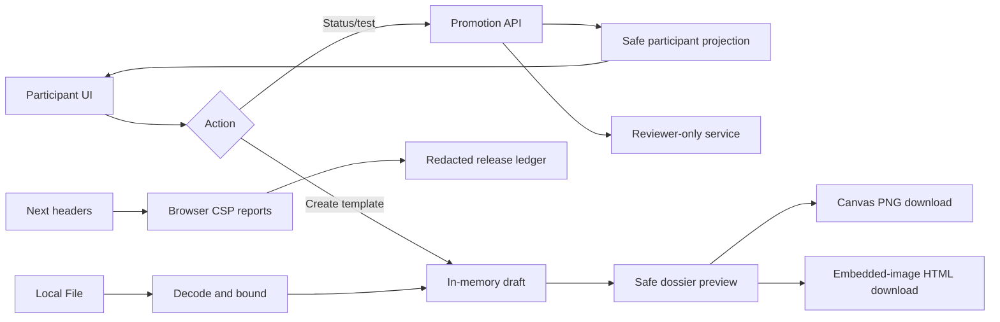

# Phase PORTIA-20: Security, accessibility и приёмка релиза — Research

**Researched:** 2026-11-03
**Domain:** Next.js App Router, browser accessibility, CSP, release evidence, local file export
**Confidence:** MEDIUM — код и решения проекта проверены; физические устройства и staging требуют исполнения.

<user_constraints>
## User Constraints (from CONTEXT.md)

### Locked Decisions

### Визуальная переработка, добавлена владельцем после обсуждения
- **D-17:** В фазе 20 выполнить именно переработку внешнего вида паука и паутины, фона/обоев, SVG-рисунков, вкладки «Повышение» в редакторе и внутреннего приложения «Повышение». Это работа по дизайну и реализации, а не только проверка существующего вида.
- **D-18:** Вкладку и приложение «Повышение» переработать также для удобства использования полного participant/reviewer flow на PC и phone, сохранив функциональные, ролевые и безопасные контракты фазы 19.
- **D-19:** Владелец разрешил пересмотреть визуал указанных элементов в рамках фазы 20. Выбрано сохранение тёмной палитры PORTIA OS с полной перерисовкой деталей. Формат паука и точные кадры задаются UI-спецификацией и проходят владельческое одобрение; старые baselines не заменяются автоматически.
- **D-20:** Для «Повышения» сохранить структуру экранов и разделение participant/reviewer. Переработать оформление и удобство, не менять базовый порядок этапов.
- **D-21:** Из SVG-рисунков переделать только общую колбу пустых состояний «Информация» и «Новостей пока нет», а также микроскоп пустого состояния «Справочник». Существующий код переиспользует колбу и микроскоп также в других состояниях; план должен либо показать изменение всех мест использования и получить вердикт, либо выделить новые варианты для выбранных поверхностей.
- **D-22:** Добавить в выбор фона новый вариант «колбы на лабораторном штативе». Несколько колб бурлят вразнобой, каждая отдельно переливается по яркости; пузырьки допустимы и желательны. Сохранить старые варианты и текущий выбор пользователя; движение подчиняется режимам full/reduced/off.
- **D-23:** Кнопка «Создать шаблон» размещается внутри приложения «Повышение» для участника. Она открывает отдельный конструктор по виду карточки досье вируса из архива. В конструкторе редактируют текст карточки, а готовую работу локально экспортируют и передают проверяющему вне сайта. Конструктор не является основным редактором сайта и не может менять записи архива.
- **D-24:** Шаблон, его изображения и экспортный файл не сохраняются в Supabase database/storage и не отправляются через `/api/uploads`. Владелец выбрал локальные изображения, включаемые в экспорт, и два формата скачивания — PNG и HTML. Экспорт должен быть самодостаточным без обращения к серверу за изображениями; черновик во время работы остаётся в текущем сеансе.

### Настройка движения
- **D-01:** Системный `prefers-reduced-motion` не меняет режим сайта; действуют настройки движения PORTIA OS. Это осознанное решение владельца для этой фазы.
- **D-02:** В режиме «Выключены» анимации интерфейса не движутся; действие сразу показывает конечное состояние и текстовое сообщение о результате.
- **D-03:** Настройка движения относится к интерфейсу. Анимированные изображения и встроенное видео сохраняют нынешнее поведение.
- **D-04:** Переключение в «Выключены» во время анимации сразу останавливает движение, показывает конечное состояние и сохраняет уже выполненное действие.

### CSP и внешние ресурсы
- **D-05:** Перевод CSP из report-only в блокирующий режим допустим после проверки разрешённых документов, видео и изображений на физических ПК и телефоне. Каждое нарушение report-only до этого должно быть объяснено.
- **D-06:** Для внешних изображений сохраняется `img-src https:`. Инвентаризация используемых хостов нужна для проверки, но не сужает это правило до списка хостов.
- **D-07:** Если внешнее изображение не загрузилось или заблокировано, показываются неподвижная заглушка, подпись и текст «Изображение недоступно» без разрушения компоновки.
- **D-08:** Строгую CSP проверять на локальной production-сборке по LAN с физических ПК и телефона. План должен явно учитывать различие HTTP и опубликованного HTTPS для HSTS и `upgrade-insecure-requests`; локальная проверка не доказывает работу HTTPS-заголовков на опубликованном сайте.

### Решение о релизных рисках
- **D-09:** Подтверждённую medium security-находку записать в релизный отчёт. Отдельный waiver владельца не требуется; обязательный чистый production dependency audit и остальные технические gates сохраняются.
- **D-10:** Влияние medium accessibility-дефекта на релиз владелец решает после физической PC/phone UAT. Невозможность завершить основной сценарий фиксируется как FAIL до вердикта.
- **D-11:** Небольшое визуальное отличие от одобренного эталона можно задокументировать и выпустить без отдельного просмотра владельца. Не превращать упавший visual gate в PASS и не изменять утверждённый baseline без положенного одобрения.
- **D-12:** Подтверждённая неисправленная high security-находка блокирует релиз до исправления или доказательной переоценки серьёзности.

### Физическая приёмка PC/phone
- **D-13:** Владелец проходит полный чек-лист сначала на физическом ПК, затем целиком на физическом телефоне, с отдельным вердиктом для каждого устройства.
- **D-14:** Дополнительная read-only проверка опубликованного production-сайта не требуется; приёмка проводится на staging и локальной production-сборке. При этом доказательства из HTTP/LAN не подменяют HTTPS-проверку опубликованных свойств.
- **D-15:** Если после полной приёмки найден и исправлен только phone-дефект, владелец повторяет весь phone-чек-лист на новом коммите. Прежний PC-вердикт сохраняется с исходным проверенным коммитом. В журнале указать оба коммита, объём изменения и основание сохранения PC-вердикта. Все технические gates повторить на итоговом release commit. Другие изменения не подпадают под это исключение.
- **D-16:** Для каждого шага записывать PASS/FAIL, устройство и краткую заметку; при отклонении приложить снимок экрана. Итоговые PC и phone вердикты фиксировать отдельно. BLOCKED остаётся BLOCKED.

### the agent's Discretion

- Форма заглушки изображения, формат журнала приёмки и способ сбора CSP-нарушений, если соблюдены решения выше и критерии фазы.

### Deferred Ideas (OUT OF SCOPE)

## Deferred Ideas

- Единая система приложений и окон — отдельная будущая фаза.
</user_constraints>

<phase_requirements>
## Phase Requirements

| ID | Description | Research Support |
|---|---|---|
| STAB-MEDIA-07, STAB-SEC-03 | CSP, media hosts, безопасный fallback | Инвентаризация URL, report-only telemetry, PC/phone LAN и HTTPS evidence. [VERIFIED: .planning/REQUIREMENTS.md:85,95] |
| STAB-A11Y-01..04 | Keyboard, touch, labels и motion | Матрица по поверхностям, axe + ручные journeys. [VERIFIED: .planning/REQUIREMENTS.md:89-92] |
| STAB-SEC-02, STAB-SEC-05..06 | Projection, code review, audit, release risks | Сравнение participant network с allowlist, локальная security matrix, audit и risk ledger. [VERIFIED: .planning/REQUIREMENTS.md:94,97-98] |
| STAB-VIS-01..04 | Паук, фон, два SVG, «Повышение» | Отдельные visual candidates, owner approval, регрессионные flow checks. [VERIFIED: .planning/REQUIREMENTS.md:113-116] |
| STAB-TMPL-01 | Конструктор с локальными PNG/HTML | Изолированный browser state, локальное изображение и два скачивания без write-запросов. [VERIFIED: .planning/REQUIREMENTS.md:117] |
| STAB-REL-01..03, STAB-REL-05..08 | Clean release gates и PC/phone UAT | Неповторяемый технический прогон на release commit, журнал каждого устройства и перенос BLOCKED. [VERIFIED: .planning/REQUIREMENTS.md:102-109] |
</phase_requirements>

## Summary

Фаза одновременно меняет ограниченные визуальные поверхности, добавляет клиентский конструктор шаблона и закрывает релизные проверки. Необходимо планировать отдельные increments: визуальные кандидаты → одобрение владельца → реализация и проверки; локальный export; accessibility/motion; CSP/media/security; final clean checkout и физическая приёмка. UI-SPEC уже approved **для планирования**, но прямо не считает рисунки утверждёнными baseline. [VERIFIED: .planning/phases/PORTIA-20-security-accessibility-i-priemka-reliza/20-UI-SPEC.md:1-12,27-45] [VERIFIED: .planning/ROADMAP.md:305-327]

Текущий Phase 19 verifier имеет `status: gaps_found`, `score: 3/10`; STAB-PROM-15 на staging остаётся BLOCKED, CR-01 повреждает hidden/lazy media, ряд state cells BLOCKED(DATA). План 20 обязан включить явный prereq/gap disposition и не повышать статус этих проверок по косвенным evidence. [VERIFIED: .planning/phases/PORTIA-19-povyshenie-prilozheniya-redaktor-poisk-i-media/19-VERIFICATION.md:1-5,69-128]

**Primary recommendation:** сохранить существующий стек и границы API; создать локальный browser-only конструктор на platform APIs, адресно менять графику и выпускать baseline только после owner approval; финальный release gate выполнять на одном явно записанном commit. [VERIFIED: .planning/phases/PORTIA-20-security-accessibility-i-priemka-reliza/20-CONTEXT.md:17-48]

## Architectural Responsibility Map

| Capability | Primary Tier | Secondary Tier | Rationale |
|---|---|---|---|
| Рисунки, wallpaper, motion и доступность | Browser / Client | — | Декоративные слои и управление уже живут в React/CSS рабочего стола. [VERIFIED: components/portia-wallpaper.tsx:1-5,190-209; components/portia-desktop.tsx:748-772] |
| Конструктор и PNG/HTML | Browser / Client | — | D-23/24 требуют session-only state и локальный экспорт; не создавать API route. [VERIFIED: .planning/phases/PORTIA-20-security-accessibility-i-priemka-reliza/20-CONTEXT.md:23-24] |
| Participant/reviewer projection | API / Backend | Database / Storage | Публичная проекция определяется сервером, reviewer actions остаются отдельно защищёнными. [VERIFIED: app/api/promotion/test/route.ts:12-47; app/api/promotion/reviewer/route.ts:14-27] |
| CSP, security headers | Frontend Server (SSR) | CDN / Static | Сейчас headers заданы в Next config; HTTPS-поведение требует опубликованной среды. [VERIFIED: next.config.ts:3-45] [CITED: https://developer.mozilla.org/en-US/docs/Web/HTTP/Guides/CSP] |
| Evidence и релизные gates | Test / Release tooling | Physical devices | Playwright/axe и signed snapshots дают машинные результаты, owner UAT отдельно фиксирует реальные устройства. [VERIFIED: playwright.config.ts:1-76; tests/e2e/README.md:1-54] |

## Project Constraints (from AGENTS.md)

- Не читать/печатать реальные `.env*` и secret values; `.env.example` разрешён. Не обращаться к production Supabase, не выполнять production mutations; SQL изменения только на изолированной тестовой ветке/проекте. [VERIFIED: AGENTS.md:6-10]
- Не изменять, stage или commit owner paths `.planning/milestone.lock`, `.planning/forensics/`, `.planning/milestones/v1.2-incomplete-research/`, `.planning/quick/261028-c9g-portia-promotion-1-8/`, `.planning/ui-reviews/`. Stage только явным путём; запрещены `git add -A`, `git add .`, `git stash`, `git clean`, `git reset --hard`. [VERIFIED: AGENTS.md:9-10]
- BLOCKED для ролей, Postgres/RLS, staging/production и физических устройств сохраняется, пока конкретная фаза не докажет их. Figma и Codex Security не возвращать в план. [VERIFIED: AGENTS.md:11-12]
- Полный локальный check: `bash .Codex/skills/portia-check/run.sh`; `--verify-promotion` допустим, `--verify` запрещён, поскольку переписывает signed evidence. SQL/RLS/RPC/storage changes требуют `supabase-rls-reviewer`. [VERIFIED: AGENTS.md:16-29]

## Standard Stack

Новых npm пакетов не требуется: проект уже содержит нужные framework, browser test и axe dependencies. По `package.json` версии: `"next": "16.4.2"`, `"react": "19.2.6"`, `"@playwright/test": "1.64.1"`, `"@axe-core/playwright": "4.14.0"`, `"tailwindcss": "4.2.1"`. Это проверенные **пины проекта**, а не рекомендация обновления. Registry lookup 2026-11-03 вернул latest Next 16.4.4, Playwright 1.64.1, axe adapter 4.14.0. Время публикации pinned versions по npm: Next 16.4.2 — 2026-10-15, Playwright 1.64.1 — 2026-10-14, axe adapter 4.14.0 — 2026-10-15; менять Next ради этой фазы не требуется. [VERIFIED: package.json:14-42] [VERIFIED: npm registry lookup 2026-11-03]

| Tool | Version / source | Purpose |
|---|---|---|
| Next.js + React + Tailwind | Project pins above | Существующие SSR, React components и CSS. [VERIFIED: package.json:14-42] |
| Playwright + axe | Project pins above | Visual, keyboard, diagnostics, accessibility. [VERIFIED: package.json:23-42; tests/e2e/specs/accessibility.spec.ts:1-50] |
| Browser File, Canvas, Blob, URL APIs | Browser platform | Session-only local media, PNG и HTML download. [CITED: https://developer.mozilla.org/en-US/docs/Web/API/FileReader/readAsDataURL] [CITED: https://developer.mozilla.org/en-US/docs/Web/API/HTMLCanvasElement/toBlob] |

**Installation:** `npm ci` в clean checkout с committed lockfile. Пакетов для новой функции не устанавливать; Package Legitimacy Audit не нужен. [VERIFIED: tests/e2e/README.md:9-25]

## Architecture Patterns

### System Architecture Diagram



### Recommended Project Structure / exact touchpoints

| Area | Existing touchpoint | Plan action |
|---|---|---|
| Wallpaper & spider | `components/portia-wallpaper.tsx`, `components/portia-wallpaper-spider.tsx`, `lib/wallpaper-web.ts`, `app/portia.css` | Redraw body/web without drifting route geometry and leg pivots; add flask art and static reduced/off. [VERIFIED: components/portia-wallpaper.tsx:8-37,190-209; components/portia-wallpaper-spider.tsx:13-19,54-80; app/portia.css:1452-1538] |
| Wallpaper choice | `components/portia-desktop.tsx` | Add one value to whitelist and settings list, preserve `"wallpaper": ["radar", "grid", "gel", "cells", "quiet"]` and default `wallpaper: "radar"`. [VERIFIED: components/portia-desktop.tsx:47-55,1686] |
| Empty graphics | `components/portia-icons.tsx`; `components/portia-desktop.tsx`; `components/portia-desktop-documents.tsx` | Current union exactly `"dish" | "microscope" | "flask"`; use addressable variants/call sites so other microscope/flask states remain unchanged. In broadcasts one flask call covers both tabs; branch only for «Новостей пока нет», preserving the quests illustration. [VERIFIED: components/portia-icons.tsx:149-176; components/portia-desktop.tsx:1513,1568,1574-1577,1630; components/portia-desktop-documents.tsx:166] |
| Promotion | `components/portia-promotion.tsx`, `components/portia-promotion-editor-main.tsx`, ordinary/qualification editor components, `app/portia.css` | Retain separate participant/reviewer structure; improve layout and status/focus. [VERIFIED: components/portia-promotion.tsx:235-243,303-340; components/portia-promotion-editor-main.tsx:116-128] |
| Dossier/template | `components/portia-desktop-dossier.tsx`; new component and pure local-export utility **[ASSUMED path choice]** | Reuse safe visual structure only. Existing `VirusRecord` includes classification and scientist logs, so do not pass real archive record into a template or expose those fields. [VERIFIED: components/portia-desktop-dossier.tsx:40-76] |
| Security | `next.config.ts`, `lib/security-headers.test.ts`, `app/api/promotion/*`, `lib/portia-cdn.ts` | Report-only policy candidate, header tests, participant response inspection and no-store. [VERIFIED: next.config.ts:8-45; app/api/promotion/test/route.ts:12-47; lib/portia-cdn.ts:14-24] |
| Gates | `playwright.config.ts`, `tests/e2e/fixtures/diagnostics.ts`, `tests/e2e/specs/accessibility.spec.ts`, `tests/e2e/visual-candidates/`, `tests/e2e/visual/` | Extend existing lanes; approve exact bytes before tracked baselines. [VERIFIED: playwright.config.ts:12-76; tests/e2e/fixtures/diagnostics.ts:131-190; tests/e2e/README.md:28-54] |

### Pattern 1: browser-only export

Maintain draft state in a client component. Validate MIME, magic bytes/decoding and size/dimensions of each selected image before preview; derive a safe data URL for downloaded HTML. Encode text as text nodes or escaped HTML; never concatenate raw user text as markup. Render the same bounded content model to preview and Canvas, then call `canvas.toBlob(callback, "image/png")`, reject null/exception, create a Blob URL, trigger download and revoke the URL after use. Embedded images must be local data URLs, not external fetches. [CITED: https://developer.mozilla.org/en-US/docs/Web/API/HTMLCanvasElement/toBlob] [CITED: https://developer.mozilla.org/en-US/docs/Web/HTML/How_to/CORS_enabled_image] [CITED: https://developer.mozilla.org/en-US/docs/Web/API/FileReader/readAsDataURL] [CITED: https://developer.mozilla.org/en-US/docs/Web/JavaScript/Guide/Resource_management]

**Example (browser API, no in-repo discrete values):**
```ts
const blob = await new Promise<Blob>((resolve, reject) => {
  try {
    canvas.toBlob(value => value ? resolve(value) : reject(new Error("PNG encoding failed")), "image/png");
  } catch (error) { reject(error); }
});
const url = URL.createObjectURL(blob);
try { const link = document.createElement("a"); link.href = url; link.download = filename; link.click(); }
finally { setTimeout(() => URL.revokeObjectURL(url), 0); }
```
[CITED: https://developer.mozilla.org/en-US/docs/Web/API/HTMLCanvasElement/toBlob] [CITED: https://developer.mozilla.org/en-US/docs/Web/API/URL/revokeObjectURL]

### Pattern 2: CSP observation before enforcement

Current `next.config.ts` emits `"Content-Security-Policy"` already, with `"script-src 'self' 'unsafe-inline'"`, `"img-src 'self' data: blob: https:"` and `"frame-src https://docs.google.com https://sdqwqsdawqd.github.io https://www.youtube.com https://www.youtube-nocookie.com"`. Treat it as the present enforced baseline; introduce stricter candidate via `Content-Security-Policy-Report-Only` in addition, inventory browser violations on approved document/video/image scenarios, then switch only after PC/phone acceptance. Both headers coexist and enforcement remains active for the old policy. LAN HTTP cannot prove HSTS or published HTTPS behavior. [VERIFIED: next.config.ts:8-36] [CITED: https://developer.mozilla.org/en-US/docs/Web/HTTP/Guides/CSP] [CITED: https://developer.mozilla.org/en-US/docs/Web/Security/Defenses/Transport_Layer_Security]

### Anti-Patterns to Avoid

- Mounting a generic editable `VirusRecord` with live archive data: component shows classifications and scientist logs. Build a restricted template model and rendering layer. [VERIFIED: components/portia-desktop-dossier.tsx:40-76]
- Changing global flask/microscope SVG directly: current names are reused by error, archive and search surfaces. Address selected call sites. [VERIFIED: components/portia-icons.tsx:149-176; components/portia-desktop.tsx:1513,1568,1574-1577]
- Updating approved screenshots while design is merely a candidate. Existing candidate and approved lanes are separate. [VERIFIED: tests/e2e/README.md:27-42]
- Treating CSP report-only violations as harmless without disposition, or claiming HTTP LAN validates HSTS. [CITED: https://developer.mozilla.org/en-US/docs/Web/HTTP/Guides/CSP] [CITED: https://developer.mozilla.org/en-US/docs/Web/Security/Defenses/Transport_Layer_Security]

## Don't Hand-Roll

| Problem | Don't build | Use instead | Why |
|---|---|---|---|
| Browser visual automation | Custom pixel comparator | Existing Playwright screenshot lane | Current suite stores approved snapshots and diagnostics. [VERIFIED: tests/e2e/visual/apps.spec.ts:1-42; tests/e2e/README.md:27-42] |
| Accessibility scanning | New DOM-rule engine | Existing `@axe-core/playwright` plus keyboard/manual review | Axe is installed; current smoke only covers desktop and serious/critical inventory, so extend scope. [VERIFIED: package.json:27-31; tests/e2e/specs/accessibility.spec.ts:14-50] |
| Downloads | Server upload/export endpoint | Browser Canvas/Blob/File APIs | D-24 excludes server persistence. [VERIFIED: .planning/phases/PORTIA-20-security-accessibility-i-priemka-reliza/20-CONTEXT.md:23-24] [CITED: https://developer.mozilla.org/en-US/docs/Web/API/HTMLCanvasElement/toBlob] |
| Role security | Client-only hiding | Existing API projection and reviewer guard | Existing server returns `safeProjection`; UI hiding alone cannot prove network secrecy. [VERIFIED: app/api/promotion/test/route.ts:12-47; app/api/promotion/reviewer/route.ts:14-27] |

## Common Pitfalls

1. **PNG content mismatch:** DOM preview may contain multiline text beyond fixed Canvas height. Choose explicit export geometry, measure wrapping/height, reject overflow with visible HTML alternative, never silently crop. [ASSUMED implementation risk; validate on PC/phone]
2. **Tainted canvas / invalid file:** Cross-origin images make `toBlob` throw `SecurityError`; local image decoding or encoder can fail. Keep text draft and show specific retry path. [CITED: https://developer.mozilla.org/en-US/docs/Web/HTML/How_to/CORS_enabled_image] [CITED: https://developer.mozilla.org/en-US/docs/Web/API/HTMLCanvasElement/toBlob]
3. **Wrong policy boundary:** A new report-only header does not disable current enforced CSP; `upgrade-insecure-requests` is controlled by environment in Next config. Capture violated directive, blocked origin and path without secrets; avoid broad automatic allowlists. [VERIFIED: next.config.ts:3-20] [CITED: https://developer.mozilla.org/en-US/docs/Web/HTTP/Guides/CSP]
4. **Motion off still moves:** CSS currently disables SVG/wallpaper animation for reduced/off, while spider has a `requestAnimationFrame` loop and new flask layers may add animation. Test switching mid-cycle and static terminal state, including focus/feedback. [VERIFIED: app/portia.css:1452-1538; components/portia-wallpaper-spider.tsx:54-90]
5. **False release pass:** Playwright config uses CI `retries: 1` and `trace: "on-first-retry"`; release command should force `--retries=0`, retain first-failure trace if adjusting config, preserve failed artifacts and distinguish skipped/BLOCKED. [VERIFIED: playwright.config.ts:20-37; tests/e2e/README.md:19-25] [CITED: https://github.com/microsoft/playwright/blob/v1.64.1/docs/src/test-api/class-testoptions.md]
6. **Inherited Phase 19 gap:** CR-01, STAB-PROM-15, reviewer account and data-backed cells are still open in verifier. Avoid signing a Phase 20 release on unresolved inherited criteria without explicit owner disposition. [VERIFIED: .planning/phases/PORTIA-19-povyshenie-prilozheniya-redaktor-poisk-i-media/19-VERIFICATION.md:69-128,255-274]

## Environment Availability

| Dependency | Required By | Available | Version / evidence | Fallback |
|---|---|---|---|---|
| Node | Build/tests | Yes | `v22.13.1` observed in shell; matches project reference. [VERIFIED: runtime probe 2026-11-03; AGENTS.md:24-27] | — |
| npm | Dependency/audit | Yes | `10.9.2` observed. [VERIFIED: runtime probe 2026-11-03] | — |
| Playwright/axe | E2E/axe | Declared/installed | `"@playwright/test": "1.64.1"`, `"@axe-core/playwright": "4.14.0"`; binaries present. [VERIFIED: package.json:27-31; runtime probe 2026-11-03] | `npm ci` on clean checkout |
| Physical PC/phone | Owner UAT | Unverified | Owner must perform. [VERIFIED: .planning/phases/PORTIA-20-security-accessibility-i-priemka-reliza/20-CONTEXT.md:44-48] | None |
| Isolated staging roles/data | Promotion journeys | Partial/BLOCKED | Phase 19 verifier records missing reviewer and data cells. [VERIFIED: .planning/phases/PORTIA-19-povyshenie-prilozheniya-redaktor-poisk-i-media/19-VERIFICATION.md:69-128] | Seed/attested staging; no production mutation |

## Security Domain

`.planning/config.json` has `"security_enforcement": true`, `"security_asvs_level": 1`. Use ASVS as review rubric; current official ASVS stable is 5.0.0, so avoid carrying old category numbers unexamined. [VERIFIED: .planning/config.json:8-16] [CITED: https://asvs.owasp.org/]

| Area | Applies | Required local check |
|---|---|---|
| Authentication/session/access control | Yes | Participant vs reviewer response bodies; revoke and direct API denial from existing isolated staging lanes. [VERIFIED: app/api/promotion/test/route.ts:39-47; app/api/promotion/reviewer/route.ts:14-27] |
| Input validation/output encoding | Yes | Local image decoding and export HTML escaping; existing `parseJsonObject` for server commands. [VERIFIED: app/api/promotion/test/route.ts:5,50-55] [CITED: https://developer.mozilla.org/en-US/docs/Web/API/FileReader/readAsDataURL] |
| Cryptography/data protection | Yes | Existing device token digest; no template upload or new secret mechanism; inspect no-store for sensitive responses. [VERIFIED: app/api/promotion/test/route.ts:1-3,39-47; lib/portia-cdn.ts:14-24] |
| HTTP security/configuration | Yes | CSP report-only, frame/nosniff/referrer/permissions/COOP/HSTS, HTTPS distinction. [VERIFIED: next.config.ts:8-45] |

**Threat matrix:** information disclosure via response overprojection → allowlist `safeProjection` and network assertions; stored XSS via exported HTML → text escaping; tainted/oversize image → decode bounds and explicit export failure; CSP accidental breakage → report-only inventory and browser journeys; accidental production mutation → existing target guard and read-only lanes. [VERIFIED: app/api/promotion/test/route.ts:12-47; tests/e2e/README.md:46-54] [CITED: https://developer.mozilla.org/en-US/docs/Web/HTML/How_to/CORS_enabled_image]

## Release Validation Strategy

1. **Before baseline update:** candidate captures for spider/web, flask wallpaper, two SVG uses and Promotion participant/reviewer on desktop/phone, including off/reduced/full, long text and custom accent; owner approves exact visual candidates. [VERIFIED: .planning/phases/PORTIA-20-security-accessibility-i-priemka-reliza/20-UI-SPEC.md:27-45,47-74; tests/e2e/README.md:27-42]
2. **Functional/negative:** extend `accessibility.spec.ts`, Promotion role lanes, download tests. Assert PNG decodes and dimensions/content, HTML opens offline with embedded image and escaped text, no request to `/api/uploads` or Supabase on edit/export, draft survives decoder/encoder failure. [VERIFIED: tests/e2e/specs/accessibility.spec.ts:14-50; .planning/REQUIREMENTS.md:117]
3. **Security/media:** inventory approved external image/document/video hosts, capture report-only events via existing diagnostics fixture, explain every event, verify image fallback and no-store/participant-safe network responses. Check published HTTPS headers separately if allowed by D-14; otherwise mark this evidence limitation openly. [VERIFIED: tests/e2e/fixtures/diagnostics.ts:131-190; next.config.ts:8-45; .planning/phases/PORTIA-20-security-accessibility-i-priemka-reliza/20-CONTEXT.md:32-36,44-46]
4. **Final clean checkout at recorded release commit:** `npm ci`, `npm test`, `npm exec tsc -- --noEmit`, `npm run build`, `npm run lint`, `npm audit --omit=dev`, full `npm audit` with dev disposition, `npm run test:e2e -- --retries=0`, approved visual suite, axe, keyboard and diagnostics. Use `bash .Codex/skills/portia-check/run.sh build` for project's bundled local gate; visual manifest only `--verify-promotion`. Live tests need attested isolated staging and residual receipt. [VERIFIED: AGENTS.md:16-29; package.json:5-20; tests/e2e/README.md:19-54]
5. **Physical owner UAT:** PC full checklist, then phone full checklist; each step PASS/FAIL/BLOCKED with device, commit and screenshot on failure. Phone-only fix can preserve earlier PC verdict only under D-15 with documented diff and repeated all technical gates on final commit. No release closure with unresolved high finding or missing owner approval. [VERIFIED: .planning/phases/PORTIA-20-security-accessibility-i-priemka-reliza/20-CONTEXT.md:38-48; .planning/ROADMAP.md:319-327]

## Assumptions Log

| # | Claim | Section | Risk if wrong |
|---|---|---|---|
| A1 | Proposed new component/utility paths and Canvas implementation are planner choices. [ASSUMED] | Architecture | Adapt to actual code layout and browser constraints. |
| A2 | A fixed image size/decoder whitelist and PNG layout limits can be chosen within UI-SPEC discretion. [ASSUMED] | Architecture / Pitfalls | Confirm in implementation and physical UAT. |
| A3 | Published HTTPS header evidence may be unavailable under D-14, so record a limitation rather than a PASS. [ASSUMED] | Validation | STAB-SEC-03 may remain partial if HTTPS assertion is mandatory. |

## Open Questions

1. Phase 19 gap disposition: should Phase 20 explicitly own CR-01 and staging re-acceptance, or should a Phase 19 gap plan close them first? Existing verifier recommends `--gaps`; do not silently absorb without an owner/plan record. [VERIFIED: .planning/phases/PORTIA-19-povyshenie-prilozheniya-redaktor-poisk-i-media/19-VERIFICATION.md:267-274]
2. Published HTTPS: D-14 excludes extra production read-only check while D-08 acknowledges LAN cannot prove HSTS/upgrade behavior. Planner should identify existing deployed evidence or mark HTTPS-specific assertion BLOCKED/waived explicitly. [VERIFIED: .planning/phases/PORTIA-20-security-accessibility-i-priemka-reliza/20-CONTEXT.md:36,44-46]
3. Exact PNG dimensions and maximum local image byte/pixel limits: pick bounded values during implementation, then test with long text and rejected files on target browsers. [ASSUMED]

## Sources

- Internal source of truth: `.planning/ROADMAP.md:305-327`, `.planning/REQUIREMENTS.md:85-117`, `20-CONTEXT.md:14-53`, `20-UI-SPEC.md:15-143`, `19-VERIFICATION.md:1-5,69-128`; cited inline.
- Official Next.js CSP guide: https://nextjs.org/docs/app/guides/content-security-policy — nonce and dynamic rendering caveat; Context7 `/vercel/next.js`.
- Official Playwright v1.64.1 test options: https://github.com/microsoft/playwright/blob/v1.64.1/docs/src/test-api/class-testoptions.md — trace modes; Context7 `/microsoft/playwright/v1.64.1`.
- MDN: https://developer.mozilla.org/en-US/docs/Web/HTTP/Guides/CSP ; https://developer.mozilla.org/en-US/docs/Web/API/HTMLCanvasElement/toBlob ; https://developer.mozilla.org/en-US/docs/Web/HTML/How_to/CORS_enabled_image ; https://developer.mozilla.org/en-US/docs/Web/API/FileReader/readAsDataURL ; https://developer.mozilla.org/en-US/docs/Web/Security/Defenses/Transport_Layer_Security .
- W3C WCAG 2.2: https://www.w3.org/TR/WCAG22/ — focus, dragging, targets and status messages. [CITED: https://www.w3.org/TR/WCAG22/]
- OWASP ASVS: https://asvs.owasp.org/ — stable 5.0.0 and security review rubric. [CITED: https://asvs.owasp.org/]

## Metadata

**Confidence breakdown:** standard stack HIGH (opened package source and registry); architecture MEDIUM (current code verified, new browser export unimplemented); pitfalls MEDIUM (current verifier and browser docs); physical acceptance LOW until owner executes it.
**Research date:** 2026-11-03
**Valid until:** 2026-11-10 for dependency/CSP details; project decisions remain authoritative until changed.
