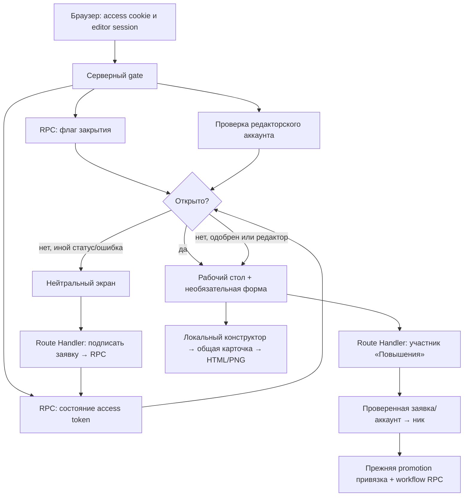

# Phase PORTIA-23: Вход по нику, «Повышение» и его регрессии — Research

**Researched:** 2026-11-12  
**Domain:** доступ посетителя по токену устройства, серверная идентичность участника, регрессии «Повышения», локальное кадрирование  
**Confidence:** HIGH для текущего кода и границ; MEDIUM для предлагаемой интеграции; live Postgres/RLS — BLOCKED

<user_constraints>
## User Constraints (from CONTEXT.md)

### Locked Decisions

#### Перенесённые решения и границы
- **D-01:** Флаг закрытия по умолчанию выключен и доступен для изменения только владельцу (Phase 21 D-05). Пока он выключен, заявка собирается, а открытый сайт работает как раньше. Включение production отложено до Phase 25.
- **D-02:** Один канонический ник Roblox (`[A-Za-z0-9_]{3,20}`), регистр не создаёт второго человека (Phase 21 D-01). Одна ожидающая заявка на ник; после отказа или отзыва действует часовая пауза, которую владелец может снять (Phase 21 D-06). Новый аппарат уже одобренного человека подаёт новую заявку и не получает автоматического одобрения (ROADMAP, ACC-07).
- **D-03:** Редактор и владелец входят существующим входом, минуя заявку по нику; ссылка на этот вход доступна с экрана заявки (ROADMAP, ACC-08). Ник для участника «Повышения» нельзя доверять браузеру: сервер получает его из одобренной заявки (ROADMAP, PROM-01). Существующий конфликт привязки устройства устраняет проверяющий сбросом (PROM-02).
- **D-04:** Ник участника «Повышения» подставляется только для одобренного сотрудника «из таблицы»; у остальных нет участия через этот путь. Уже решённые правила редакторской вкладки «Пользователи» из Phase 22 не меняются.

#### Экран заявки и ожидания
- **D-05:** Внешний вид и точное место формы заявки на загрузочном экране при выключенном закрытии владелец оставил на усмотрение исполнителя. Форма должна собирать заявки, не прерывая доступ к открытому сайту; при включённом закрытии не одобренный видит только нейтральный экран, как требует ROADMAP.
- **D-06:** После отправки заявки показывать анимацию ожидания. После одобрения на том же устройстве экран автоматически сменяется рабочим столом, без кнопки «Войти» и повторного ввода ника. Переход следует подтверждённому серверному состоянию, а не одному факту отправки.
- **D-07:** Для отклонённого и отозванного действуют отдельные нейтральные состояния и повторная заявка после часовой паузы, согласно ROADMAP и Phase 21. Ответы не должны раскрывать, одобрен ли такой ник на чужом устройстве.

#### Редактор как участник «Повышения»
- **D-08:** Редактор может пользоваться «Повышением» как участник только при наличии собственной одобренной заявки «из таблицы». Без неё функции редактора остаются доступны, но участником «Повышения» через ручной ввод ника он не становится. — **Reversibility:** costly — изменение затронет единый контракт определения участника в маршрутах «Повышения», проверку серверного ника и возможную схему связки редактора с заявкой.

#### Фото конструктора шаблона
- **D-09:** Окно «Видимая часть» работает примерно как уже существующее окно для картинок «Базы вирусов»: пользователь меняет размер и положение локального фото под рамкой, выбирая видимую область. Размер места фото в карточке остаётся прежним; изменение масштаба меняет видимые ширину и высоту фотографии вместе, сохраняя пропорции, без растяжения по одной оси.
- **D-10:** Применённый кадр одинаков в предпросмотре и скачиваемых HTML/PNG. Конструктор остаётся локальным: фото и черновик не сохраняются в базе. Сброс, отмена и применение следуют существующей модели окна «Видимая часть».

### the agent's Discretion
- Конкретное оформление формы при выключенном закрытии, вид анимации ожидания, частоту проверки статуса и тексты промежуточных состояний в рамках ACC-01..08 и D-05..07.
- Точный UI при конфликте старой привязки устройства и понятные сообщения о недоступности «Повышения» в рамках PROM-02..04.
- Как переиспользовать существующее окно кадрирования и хранить параметры кадра только в локальном черновике и экспорте.

### Deferred Ideas (OUT OF SCOPE)
Новых идей вне объёма фазы не возникло.

### Reviewed Todos (not folded)
- `.planning/todos/pending/2026-11-03-info-phone-sections-toggle.md`, `.planning/todos/pending/2026-11-07-desktop-visual-overhaul.md` — Phase 26.
- `.planning/todos/pending/2026-11-08-access-levels.md` — Phase 24.
- Паук, границы окон и анимация ярлыков из `.planning/todos/pending/2026-10-28-stabilize-promotion-and-desktop-ui.md` — не регрессии «Повышения» Phase 23.
</user_constraints>

<phase_requirements>
## Phase Requirements

| ID | Description | Research Support |
|---|---|---|
| ACC-01 | Заявка по нику и выбранному типу на загрузочном экране | Готовые нормализатор, токен и подписанный submit RPC; добавить маршрут и UI. [VERIFIED: lib/nickname.ts:6-22; lib/access-session.ts:11-80; supabase/migrations/20261109000000_portia_access_foundation.sql:185-294] |
| ACC-02 | Нейтральный экран до одобрения при закрытии | Серверный gate до монтирования `PortiaDesktop`; прямые публичные API остаются отдельной границей Phase 25. [VERIFIED: app/page.tsx:1-6; .planning/ROADMAP.md:128-132] |
| ACC-03 | Возврат на том же устройстве | HttpOnly access cookie и `portia_access_resolve`. [VERIFIED: lib/access-session.ts:78-91; supabase/migrations/20261109000000_portia_access_foundation.sql:297-344] |
| ACC-05 | Нейтральность и лимиты | SQL уже считает лимиты и скрывает чужую pending/паузу. [VERIFIED: supabase/migrations/20261109000000_portia_access_foundation.sql:234-285] |
| ACC-06 | Повтор после отказа/отзыва | RPC возвращает паузу своему устройству; UI ждёт серверный `retryAt`. [VERIFIED: supabase/migrations/20261109000000_portia_access_foundation.sql:270-284,336-339] |
| ACC-07 | Новое устройство без автоодобрения | Проверить отдельный токен, pending и решение редактора; не восстанавливать доступ по одному нику. [VERIFIED: supabase/migrations/20261109000000_portia_access_foundation.sql:237-289] |
| ACC-08 | Вход редактора | Существующий `/owner-login` и проверка `getEditorAccess`. [VERIFIED: app/owner-login/page.tsx:8-20,63-64] |
| PROM-01 | Ник только из одобренной заявки на сервере | Нынешние маршруты принимают `nickname`; нужен единый серверный resolver и проверка прямых RPC. [VERIFIED: app/api/promotion/status/route.ts:9-18; app/api/promotion/requests/route.ts:11-20] |
| PROM-02 | Сохранить привязки и сброс | Оставить прежние cookie, digest, binding и owner reset. [VERIFIED: lib/portia-device-binding.ts:3-30; supabase/migrations/20261101000000_portia_baseline.sql:349-356,623-638] |
| PROM-03 | Регрессии даты, заявок, причин, восстановления | Зафиксировать baseline и проверить весь путь eligibility → POST → RPC → свежая проекция. [VERIFIED: components/portia-promotion.tsx:340-443; lib/portia-promotion-api.ts:224-295] |
| PROM-04 | Редактор банков | Сохранить локальный черновик при отказе и проверить CRUD обеих веток. [VERIFIED: components/portia-promotion-ordinary-editor.tsx:19-105; app/api/promotion/banks/route.ts:98-125] |
| PROM-05 | Кадрирование шаблона | Повторно использовать `ImageFramingEditor`; кадр хранить в локальном снимке, рендерить в одной карточке. [VERIFIED: components/portia-image-framing.tsx:34-75; components/portia-template-builder.tsx:126-155,329-359] |
</phase_requirements>

## Summary

Основа заявок уже есть, но пользовательский маршрут ещё не подключён. `app/page.tsx` сразу возвращает рабочий стол; `app/api/access/route.ts` проверяет только доступ редактора. HttpOnly cookie доступа, HMAC и RPC заявки/состояния существуют. Значит первый вертикальный срез — серверная проверка флага и состояния устройства, маршрут заявки и нейтральный экран, а в открытом режиме неблокирующая форма поверх работающего сайта. [VERIFIED: app/page.tsx:1-6; app/api/access/route.ts:1-28; lib/access-session.ts:7-91; .planning/phases/PORTIA-23-vhod-po-niku-povyshenie-i-ego-regressii/23-UI-SPEC.md:96-117]

Главный риск — смешение двух видов устройства и двух источников ника. У доступа и «Повышения» разные cookie и HMAC-пространства; текущие маршруты «Повышения» читают ник из query/body, а RPC допускают анонимный вызов. Получать участника надо только из одобренной заявки текущего access-токена либо проверенной собственной заявки редакторского аккаунта; существующий promotion cookie использовать лишь для проверки прежней привязки, а не для выбора человека. [VERIFIED: lib/access-session.ts:7-27; lib/portia-device-binding.ts:3-30; lib/portia-promotion-api.ts:193-245; supabase/migrations/20261101000000_portia_baseline.sql:1596-1599] Схема окончательного RPC-ограничения — проектное решение, требующее проверки на изолированном Postgres. [ASSUMED]

Локальные тесты проверили 100 текущих случаев без ошибок, но это baseline, а не воспроизведение жалоб на настоящих ролях и базе. Phase 22 фиксирует неприменённые миграции и BLOCKED для Postgres/RLS, staging и физических устройств; нельзя повышать эти пункты до PASS после статических тестов. [VERIFIED: executed 2026-11-12 `node --experimental-strip-types --test lib/portia-promotion-api.test.ts lib/portia-promotion-ui.test.ts lib/portia-template-builder.test.ts lib/image-framing-crop.test.ts lib/access-requests.test.ts lib/access-closure.test.ts` — 100 pass, 0 fail; .planning/phases/PORTIA-22-vkladka-polzovateli-i-karkas-tokenov-stilya/22-VERIFICATION.md:148-150]

**Primary recommendation:** построить единый серверный контракт доступа/участника, затем закрыть два потока «Повышения» и локальное кадрирование отдельными проверяемыми срезами. [ASSUMED]

## Architectural Responsibility Map

| Capability | Primary Tier | Secondary Tier | Rationale |
|---|---|---|---|
| Заявка и лимиты | Database / Storage | API / Backend | SQL уже владеет дедупликацией, паузой и лимитами; сервер подписывает запрос. [VERIFIED: supabase/migrations/20261109000000_portia_access_foundation.sql:189-294] |
| Проверка текущего устройства и флага | Frontend Server (SSR) | Database / Storage | Куки/флаг проверяются до выдачи закрытого desktop. [CITED: https://nextjs.org/docs/app/api-reference/functions/cookies] |
| Нейтральный экран и анимация | Browser / Client | Frontend Server (SSR) | UI показывает уже подтверждённый сервером статус; видимость вкладки управляет опросом, не допуском. [VERIFIED: .planning/phases/PORTIA-23-vhod-po-niku-povyshenie-i-ego-regressii/23-UI-SPEC.md:98-117] |
| Ник участника «Повышения» | API / Backend | Database / Storage | Ник выводится из одобренного токена/аккаунта; browser input не выбирает человека. [VERIFIED: .planning/phases/PORTIA-23-vhod-po-niku-povyshenie-i-ego-regressii/23-CONTEXT.md:24-32] |
| Прежняя привязка «Повышения» | Database / Storage | API / Backend | SQL хранит привязку nickname/token, API предъявляет старый digest. [VERIFIED: supabase/migrations/20261101000000_portia_baseline.sql:349-356,779-820] |
| Кадр и экспорт | Browser / Client | — | Локальная модель и общий рендер карточки для preview/HTML/PNG. [VERIFIED: lib/portia-template-dossier.ts:1-21; components/portia-template-builder.tsx:142-155,329-359] |

## Standard Stack

Новых внешних пакетов фаза не требует; используйте уже закреплённые версии проекта. [VERIFIED: package.json:26-45] Устанавливать дополнительную библиотеку ради gate, опроса, HMAC или кадра не требуется по текущей архитектуре. [ASSUMED]

| Library / runtime | Version in repository | Purpose |
|---|---|---|
| Next.js | `"next": "16.4.5"` | App Router, серверные страницы и route handlers. [VERIFIED: package.json:26-32] |
| React | `"react": "19.2.6"` | Клиентские состояния gate/«Повышения». [VERIFIED: package.json:26-32] |
| Supabase SSR | `"@supabase/ssr": "^0.12.7"` | Существующий cookie-based редакторский клиент. [VERIFIED: package.json:26-32; lib/supabase/server.ts:1-33] |
| Supabase JS | `"@supabase/supabase-js": "^2.117.3"` | RPC через публичный и request-scoped клиенты. [VERIFIED: package.json:26-32; lib/supabase/server.ts:7-33] |
| Node | `"node": ">=22.13.0 <23"`; локально `v22.13.1` | Эталон тестов; в этой сессии Node найден в `%TEMP%`. [VERIFIED: package.json:5-7; environment probe 2026-11-12] |

**Официальные ограничения:** `cookies()` читает запрос в Server Component, но устанавливает cookie только Route Handler/Server Function. [CITED: https://nextjs.org/docs/app/api-reference/functions/cookies] PostgreSQL `SECURITY DEFINER` требует безопасного `search_path` и явного EXECUTE grant. [CITED: https://www.postgresql.org/docs/current/sql-createfunction.html]

## Architecture Patterns

### System Architecture Diagram



Проверка допуска должна закончиться до монтирования `PortiaDesktop` при закрытии: сейчас `BootScreen` находится внутри уже смонтированного desktop, поэтому наложение на него не закрывает DOM приложений. [VERIFIED: app/page.tsx:1-6; components/portia-desktop.tsx:1632-1645,1913-1929] При сетевой ошибке флага/состояния сервер не должен трактовать её как одобрение. [ASSUMED] Редакторский bypass проверяется `getUser()` и `getEditorAccess()` на сервере, не наличием cookie как таковой. [VERIFIED: app/api/access/route.ts:11-22; app/owner-login/page.tsx:16-20]

### Recommended Project Structure

- Добавить один серверный resolver посетителя и повторно использовать его в странице, route handler статуса и маршрутах «Повышения». [ASSUMED]
- Сохранить SQL-правила как forward-only миграцию поверх Phase 21/22; не редактировать применимые старые миграции. [VERIFIED: .planning/phases/PORTIA-23-vhod-po-niku-povyshenie-i-ego-regressii/23-CONTEXT.md:76-85]
- Оставить локальные операции шаблона в `lib/portia-template-dossier.ts` и существующем компоненте; кадр не должен попасть в `virus.infectedImage` или `mutation.image`, которые модель очищает. [VERIFIED: lib/portia-template-dossier.ts:93-103]

### Pattern 1: Серверная идентичность участника

Для посетителя сервер читает `portia_access`, считает `access:` digest и вызывает `portia_access_resolve`. Выбор участника допускается лишь для подтверждённой активной заявки с типом «из таблицы»: точные значения origin — `"sheet"`, `"outside"`. [VERIFIED: lib/access-levels.ts:23-27 — `"sheet"`, `"outside"`] Текущий `AccessState` содержит только `state`, `nickname`, `level`, а SQL `resolve` не возвращает `origin`; понадобится узкий авторитетный RPC/расширение контракта без раскрытия чужих данных. [VERIFIED: lib/access-session.ts:11-27,78-91; lib/access-store.ts:57-61,118-135; supabase/migrations/20261109000000_portia_access_foundation.sql:297-344] Для редактора авторитетным звеном служит `requested_by` в его одобренной заявке и активный person с тем же каноническим ником; editor-сессия сама по себе даёт редакторские функции, но не участие. [VERIFIED: supabase/migrations/20261109000000_portia_access_foundation.sql:88-112; supabase/migrations/20261112000000_portia_access_decision_mark.sql:52-90] `account_id` нельзя использовать как единственный критерий: при одобрении дополнительного устройства активного person ветка `device_added` не обновляет `account_id` или `origin`. [VERIFIED: supabase/migrations/20261112000000_portia_access_decision_mark.sql:52-68,89-98] Связка редактора, одобренного до входа без `requested_by`, не доказывается знанием ника; нужен новый одобренный запрос или иной явно проверенный процесс. [ASSUMED]

### Pattern 2: Один gate для открытия и входа

Сервер всегда проверяет флаг; при выключенном флаге открывает существующий рабочий стол и предлагает заявку, при включённом закрытии выдаёт desktop только одобренному устройству или редактору. Экран статуса опрашивает только свою access cookie и игнорирует устаревшие ответы. [VERIFIED: .planning/phases/PORTIA-23-vhod-po-niku-povyshenie-i-ego-regressii/23-UI-SPEC.md:98-117; supabase/migrations/20261109000000_portia_access_foundation.sql:655-668] `submit` подписывается на сервере и возвращает чужому устройству нейтральный `unavailable`; UI не должен называть это собственной pending заявкой. [VERIFIED: lib/access-store.ts:90-115; supabase/migrations/20261109000000_portia_access_foundation.sql:262-285]

### Pattern 3: Старую promotion привязку только проверять

Не переносить `portia_access` в `portia_promo_device`: digest имеют разные метки `"access:"` и `"device:"`. [VERIFIED: lib/access-session.ts:24-27 — `"access:"`; lib/portia-device-binding.ts:23-25 — `"device:"`] После первого разрешённого POST сохранённая promotion cookie остаётся прежней; mismatch даёт конфликт, а сброс через существующую команду проверяющего. [VERIFIED: lib/portia-promotion-api.ts:241-294; supabase/migrations/20261101000000_portia_baseline.sql:779-820,623-638] Прямые RPC с ником требуют отдельного security review: сейчас `portia_promo_submit_request` и `portia_promo_public_status` доступны `anon, authenticated`; обычный HTTP gate их не ограничивает. [VERIFIED: supabase/migrations/20261101000000_portia_baseline.sql:1596-1599] Если контракт меняется, исключить старую callable overload и обновить grants, fingerprint и expected-authz. [CITED: https://www.postgresql.org/docs/current/sql-createfunction.html]

### Pattern 4: Кадр как часть локального снимка

Нормализованный кадр (`"x"`, `"y"`, `"zoom"`) хранить рядом с изображением каждого слота; на замену/удаление очищать кадр только этого слота. [VERIFIED: lib/image-framing.ts:7-45 — `"x"`, `"y"`, `"zoom"`; lib/portia-template-dossier.ts:16-21,218-225] Включить кадр в `templateDossierSnapshotKey`; один `TemplateCard` уже используется видимым preview и скрытым export frame. [VERIFIED: lib/portia-template-dossier.ts:250-262; components/portia-template-builder.tsx:142-155,329-359,497-499] Сначала измерить фактическую геометрию слота: CSS `object-fit: contain` и ограничения высоты отличаются от готового `tile` 4:3, поэтому прямой выбор `box="tile"` без проверки может показать другой кадр. [VERIFIED: app/portia.css:1137-1140,1177-1181; lib/image-framing-crop.ts:57-67]

### Anti-Patterns to Avoid

- Считать отправленную заявку одобрением либо показывать desktop под нейтральным fullscreen overlay. [VERIFIED: .planning/phases/PORTIA-23-vhod-po-niku-povyshenie-i-ego-regressii/23-UI-SPEC.md:98-117]
- Передавать `nickname` из browser query/body в promotion API как авторитетную идентичность. [VERIFIED: app/api/promotion/status/route.ts:9-18; app/api/promotion/requests/route.ts:11-20]
- Сбрасывать существующий promotion binding при несовпадении ника или автоматически связывать новый аппарат. [VERIFIED: supabase/migrations/20261101000000_portia_baseline.sql:779-820]
- Считать статический SQL-тест доказательством применённой миграции или RLS. [VERIFIED: .planning/phases/PORTIA-22-vkladka-polzovateli-i-karkas-tokenov-stilya/22-VERIFICATION.md:1-4]

## Don't Hand-Roll

| Problem | Don't Build | Use Instead | Why |
|---|---|---|---|
| Ник и его канонический ключ | Новый regex/нормализатор в UI | `parseNicknameInput` и SQL `portia_access_nickname_key` | Единое правило уже проверяется parity test. [VERIFIED: lib/nickname.ts:6-22; supabase/migrations/20261109000000_portia_access_foundation.sql:35-46] |
| Защита от частых заявок | Только client timer | `portia_access_submit_request` | DB считает лимиты под lock. [VERIFIED: supabase/migrations/20261109000000_portia_access_foundation.sql:234-260] |
| Привязка и HMAC | Новая cookie или digest | `access-session` и `portia-device-binding` | Сохранение независимых пространств и старых привязок. [VERIFIED: lib/access-session.ts:7-27; lib/portia-device-binding.ts:3-30] |
| Кадр | Второй crop editor | `ImageFramingEditor` и `normalizeImageFraming` | Готовые drag, keyboard, reset, apply. [VERIFIED: components/portia-image-framing.tsx:34-75,250-257; lib/image-framing.ts:26-45] |
| HTML и PNG | Отдельные реализации кадра | Общий `TemplateCard` → export snapshot | Одинаковая разметка уже питает оба формата. [VERIFIED: components/portia-template-builder.tsx:142-155,329-359] |

## Runtime State Inventory

| Category | Items Found | Action Required |
|---|---|---|
| Stored data | Access requests/people/settings и promotion bindings — отдельные таблицы и токены. Три access миграции ещё не применялись по Phase 22; фактическое live состояние не проверялось. [VERIFIED: supabase/migrations/20261109000000_portia_access_foundation.sql:66-118,638-668; supabase/migrations/20261101000000_portia_baseline.sql:349-356; .planning/phases/PORTIA-22-vkladka-polzovateli-i-karkas-tokenov-stilya/22-VERIFICATION.md:148-150] | Никакого production backfill. Forward-only миграция и проверки только изолированного проекта; сохранить старые binding rows. |
| Live service config | Флаг живёт в SQL row `"main"`; его значение в реальной среде не опрашивалось. [VERIFIED: supabase/migrations/20261109000000_portia_access_foundation.sql:638-668 — `"main"`] | В тестовом проекте проверить OFF/ON; production включение принадлежит Phase 25. |
| OS-registered state | Связанных с входом регистраций в просмотренных исходниках не выявлено; ОС не проверялась. [ASSUMED] | Не планировать миграцию ОС без факта; оставить как непроверенную средовую границу. |
| Secrets/env vars | Код называет `"PORTIA_PROMOTION_DEVICE_SECRET"` и `"PORTIA_ACCESS_SUBMIT_SECRET"`; значения не читались. [VERIFIED: lib/portia-device-binding.ts:6-17 — `"PORTIA_PROMOTION_DEVICE_SECRET"`; lib/access-session.ts:35-46 — `"PORTIA_ACCESS_SUBMIT_SECRET"`] | Настройка только изолированной среды; реальный `.env*` не читать. Новое секретное поле без явной необходимости не вводить. |
| Build artifacts | Локальные артефакты сборки не инспектировались; при изменении gate нужен новый build, а живой Netlify deploy остаётся BLOCKED. [ASSUMED] | Запустить локальную сборку; не считать её staging/production проверкой. |

## Common Pitfalls

1. **Утечка через ранний mount.** В нынешнем коде `BootScreen` лишь сосед desktop, а не gate. Проверять отсутствие desktop DOM и сетевых вызовов его приложений до ответа сервера. [VERIFIED: components/portia-desktop.tsx:1632-1645]
2. **Ложный вход нового устройства.** `approved` для одного access token не подтверждает другой. Проверить новое cookie/профиль браузера, pending и ручное решение. [VERIFIED: supabase/migrations/20261109000000_portia_access_foundation.sql:237-289,313-339]
3. **Утечка статуса чужого ника.** `unavailable`, `throttled` и own `cooldown` должны отображаться без чужого статуса. Проверить одинаковые публичные сообщения для занятого/одобренного ника на чужом устройстве. [VERIFIED: supabase/migrations/20261109000000_portia_access_foundation.sql:247-285]
4. **Редактор без собственной заявки.** Роль редактора даёт bypass сайта, но не разрешение участвовать в «Повышении». `requested_by` может быть `null` у гостевой заявки; не связывать её по совпавшему нику. Проверка только `person.account_id` пропустит законное дополнительное устройство редактора, потому что одобрение active person этого поля не обновляет. [VERIFIED: supabase/migrations/20261109000000_portia_access_foundation.sql:88-112; supabase/migrations/20261112000000_portia_access_decision_mark.sql:52-68]
5. **Разные статусы в POST/GET.** Существующий POST сообщает успех, затем делает отдельный GET; при временной ошибке состояние может остаться stale. Планировать тест успешного POST, свежей проекции и частичного сбоя отдельно для каждой карточки. [VERIFIED: components/portia-promotion.tsx:413-443]
6. **Дата с лишней пунктуацией.** Сейчас `promotionAvailabilityText` формирует числовую дату и время, `formatDate` добавляет `МСК`; текущий источник не подтверждает живую двойную точку. Сначала воспроизвести точный экран/значение/локаль, затем исправить лишь воспроизведённый случай. [VERIFIED: lib/portia-promotion.ts:139-147; components/portia-promotion.tsx:38-43]
7. **Несовпадение crop preview/export.** `TemplateCard` общий, но кадр пока не входит в модель и рендер; тестировать один снимок на нескольких zoom, оба типа слота и HTML/PNG. [VERIFIED: lib/portia-template-dossier.ts:16-21,250-262; components/portia-template-builder.tsx:126-155,329-359]
8. **Ошибки банка съедают черновик.** В двух редакторах подтверждённое состояние приходит после команды; проверять отказ API и сохранение текста/количества/порядка, а также выбранное значение input. [VERIFIED: components/portia-promotion-ordinary-editor.tsx:19-105; app/api/promotion/banks/route.ts:98-125]

## Code Examples

### Чтение доверенного access-токена на сервере

```ts
// Existing APIs: lib/access-session.ts:14-27,78-91; lib/access-store.ts:118-135.
const token = readAccessToken(request.headers);
const tokenHash = token ? accessTokenDigest(token, accessSessionSecret()) : null;
const device = tokenHash ? await resolveAccess(client, tokenHash) : null;
// Branch on confirmed device state and server-side origin, never on browser nickname.
```

`portia_access_resolve` сейчас возвращает ровно `"none"`, `"pending"`, `"approved"`, `"rejected"`, `"revoked"` (вербатим значения из TypeScript union); у `"approved"` нет `origin`, поэтому пример намеренно не делает вывод «из таблицы». [VERIFIED: lib/access-store.ts:57-61 — `"none"`, `"pending"`, `"approved"`, `"rejected"`, `"revoked"`]

### Кадр в существующей карточке

```ts
// Existing APIs: lib/image-framing.ts:26-45; components/portia-image-framing.tsx:34-43.
const framing = normalizeImageFraming(draftFraming);
const styles = imageFramingStyles(framing);
// Apply styles to the same local image in visible TemplateCard and export frame.
```

## Environment Availability

| Dependency | Required By | Available | Version | Fallback |
|---|---|---|---|---|
| Node | тесты/сборка | ✓ | 22.13.1, обнаружен в temp | проект разрешает только 22.x. [VERIFIED: package.json:5-7; environment probe 2026-11-12] |
| npm | тесты/сборка | ✓ | 10.9.2 | — [VERIFIED: environment probe 2026-11-12] |
| Git | учёт изменений | ✓ | путь обнаружен | — [VERIFIED: environment probe 2026-11-12] |
| psql / Docker | живой локальный Postgres | ✗ в PATH | — | Изолированный тестовый проект; его наличие/доступ не проверены. [VERIFIED: environment probe 2026-11-12] |
| Supabase test branch/project | живые RPC/RLS/роли | BLOCKED | — | Локальные тесты только частичная проверка. [VERIFIED: .planning/phases/PORTIA-22-vkladka-polzovateli-i-karkas-tokenov-stilya/22-VERIFICATION.md:148-150] |

## Security Domain

| ASVS Category | Applies | Standard Control |
|---|---|---|
| V2 Authentication | yes | Доверенный access token и проверенный редакторский `getUser()`. [VERIFIED: lib/access-session.ts:7-27; app/api/access/route.ts:11-22] |
| V3 Session Management | yes | HttpOnly/Secure/SameSite access и promotion cookies; токены на сервере только через HMAC digest. [VERIFIED: lib/access-session.ts:24-27,78-91; lib/portia-device-binding.ts:23-40] |
| V4 Access Control | yes | Серверный gate + SQL RPC/grants; прямые promotion RPC закрываются узким контрактом Phase 23, а production flip остаётся Phase 25. [VERIFIED: supabase/migrations/20261101000000_portia_baseline.sql:1596-1599] |
| V5 Input Validation | yes | `parseNicknameInput`, typed RPC replies, bounded JSON. [VERIFIED: lib/nickname.ts:6-22; lib/access-store.ts:83-135; app/api/promotion/requests/route.ts:10-16] |
| V6 Cryptography | yes | Node `createHmac` и существующие секреты; собственный алгоритм не вводить. [VERIFIED: lib/access-session.ts:1-27] |

Обозначения V2–V6 в таблице соответствуют ASVS 4.0.3, как в шаблоне исследователя; текущий ASVS 5.0.0 перенумеровал главы (Authentication 06, Session 07, Authorization 08, Cryptography 11). При записи конкретных требований указывать версию, чтобы план не смешал номера. [CITED: https://cornucopia.owasp.org/taxonomy/asvs-4.0.3] [CITED: https://cornucopia.owasp.org/taxonomy/asvs-5.0]

**Threats:** подмена browser nickname → чужая promotion проекция/POST (Spoofing/Information disclosure); direct RPC bypass → тот же риск (Elevation); повторные заявки → очередь/лимит (Denial of service); ошибка/кеш gate → преждевременный desktop (Information disclosure). Митигировать серверной идентичностью, RPC правами, DB лимитами и `no-store`. [VERIFIED: app/api/promotion/status/route.ts:9-18; supabase/migrations/20261101000000_portia_baseline.sql:1596-1599; supabase/migrations/20261109000000_portia_access_foundation.sql:247-260; lib/portia-cdn.ts:15-18] Публичные content/employee API пока имеют CDN cache; полный запрет анонимного чтения в дорожной карте относится к Phase 25, поэтому UI gate Phase 23 не следует объявлять полной защитой данных. [VERIFIED: app/api/content/route.ts:17-34; app/api/employees/route.ts:14-18; .planning/ROADMAP.md:122-143]

## Verification and Evidence Plan

`workflow.nyquist_validation` явно `false`, поэтому отдельная Validation Architecture не требуется. [VERIFIED: .planning/config.json:4-17] Практический план тестов нужен из-за требований фазы:

- Чистые unit/API-тесты: матрица OFF/ON × no token/pending/approved/rejected/revoked × редактор/не редактор; request responses без чужого статуса; повтор нового устройства; stale/ошибка; запрет browser nickname; прежняя promotion cookie и mismatch. [ASSUMED]
- Оба POST «Повышения»: eligibility и точная причина отказа, `201` → pending в своей карточке, неуспех → черновик и возможность повтора; день/месяц/год без двойной точки. Текущий baseline 100/100 прошёл, но не доказывает жалобы. [VERIFIED: executed targeted test command 2026-11-12 — 100 pass, 0 fail; components/portia-promotion.tsx:283-312,413-443]
- Bank CRUD: число заданий, добавление/правка/удаление заданий и вопросов, confirmation и сохранение текста после ошибки. [VERIFIED: .planning/phases/PORTIA-23-vhod-po-niku-povyshenie-i-ego-regressii/23-UI-SPEC.md:119-125]
- Кадр: чистая геометрия плюс браузерное сравнение preview/HTML/PNG для основного фото и мутаций на разных zoom; проверка отмены, сброса, замены и удаления одного слота. [VERIFIED: .planning/phases/PORTIA-23-vhod-po-niku-povyshenie-i-ego-regressii/23-UI-SPEC.md:127-131]
- Локальный итог: `npm test`, `npm exec tsc -- --noEmit`, `npm run lint`, визуальный manifest test и `--verify-promotion` через `/portia-check`; локальный build отдельно. Запрещённый `--verify` не запускать. [VERIFIED: AGENTS.md:19-30; .agents/skills/portia-check/SKILL.md:1-18]
- Живые Postgres/RLS, роли, staging, production и физические устройства оставлять `BLOCKED` до отдельного подтверждения на разрешённой среде; SQL изменения — только forward-only и с `supabase-rls-reviewer`. [VERIFIED: AGENTS.md:7-32; .planning/phases/PORTIA-22-vkladka-polzovateli-i-karkas-tokenov-stilya/22-VERIFICATION.md:1-4]

## Project Constraints (from AGENTS.md)

- Отвечать по-русски; стек Next.js App Router, React 19, TypeScript, Tailwind 4, Supabase SSR, Netlify. [VERIFIED: AGENTS.md:1-5]
- Не использовать production Supabase, реальные секреты или service-role; не изменять production; SQL только изолированный test branch/project. [VERIFIED: AGENTS.md:7-9]
- Не читать реальные `.env*`; `.env.example` разрешён. [VERIFIED: AGENTS.md:9-10]
- Не изменять, не stage и не commit owner paths, перечисленные в AGENTS; stage только явным путём; запреты на `git add -A`, `git add .`, stash, clean, hard reset. [VERIFIED: AGENTS.md:10-12]
- Не записывать BLOCKED как PASS; роли, Postgres/RLS, staging/production, физические устройства остаются BLOCKED до доказательства. [VERIFIED: AGENTS.md:12-13]
- Не возвращать Figma и Codex Security в план; сообщение project guard означает смену подхода. [VERIFIED: AGENTS.md:13-16]
- Локальные команды и запрет `--verify` брать из AGENTS/`portia-check`; эталон Node 22.13.1; для SQL/RLS/RPC/storage изменений обязателен `supabase-rls-reviewer`. [VERIFIED: AGENTS.md:18-32]

## Assumptions Log

| # | Claim | Section | Risk if Wrong |
|---|---|---|---|
| A1 | Единый серверный resolver и отдельный RPC/расширение `resolve` — лучший способ связать access identity с Promotion. | Summary, Architecture | Может потребоваться другой механизм связки после live проверки. |
| A2 | Редактор с гостевой заявкой без `requested_by` подаёт собственную аутентифицированную заявку через «Повышение»; UI и серверный маршрут включены в планы 23-03/04. | Architecture | Проверить ownership и одобрение на изолированном Postgres перед live PASS. |
| A3 | Отказ проверки флага/состояния должен давать нейтральный экран в закрытом режиме. | Architecture | Может кратковременно скрыть открытый сайт при сбое до получения флага. |
| A4 | В фазе не нужны новые npm пакеты. | Standard Stack | Неожиданная интеграционная потребность повлечёт package legitimacy audit. |
| A5 | Локальные артефакты/OS регистрации не требуют миграции. | Runtime Inventory | Невыявленное runtime состояние потребует отдельного шага. |

## Open Questions (RESOLVED)

1. **RESOLVED — прямые promotion RPC.** План 23-03 создаёт узкие DB entry points: участник определяется внутри транзакции по активной одобренной заявке `origin='sheet'` текущего access token либо по одобренной заявке с `requested_by = auth.uid()` проверенного редактора. Старые nickname-selecting EXECUTE grants/overloads отзываются; прежние promotion cookie, digest, строки привязки и сброс проверяющим сохраняются как проверка конфликта. Офлайн negative tests обязательны; прямые вызовы, роли и RLS остаются BLOCKED до исполнения на явно изолированном Postgres. Production flip остаётся Phase 25. [VERIFIED: supabase/migrations/20261101000000_portia_baseline.sql:1596-1599]
2. **RESOLVED — собственная заявка редактора.** После существующего входа редактор без собственной одобренной заявки получает доступную форму «из таблицы» в «Повышении». Отдельный авторизованный route проверяет `getUser()` и права редактора, использует существующие серверные подпись, access token/cookie и лимиты; SQL записывает `requested_by = auth.uid()` из сессии вызывающего, не из тела запроса. GET собственного статуса требует одновременно `auth.uid()` и токен заявки. Введённый ник является лишь предметом заявки: до её одобрения он не задаёт личность участника. Гостевая заявка с `requested_by IS NULL` и одно лишь `person.account_id` не доказывают собственность. План 23-04 показывает pending/rejected/revoked и после одобрения переключает на карточки участника без ручного входа. [VERIFIED: supabase/migrations/20261109000000_portia_access_foundation.sql:88-112,287-294; supabase/migrations/20261112000000_portia_access_decision_mark.sql:52-90]
3. **RESOLVED — регрессии PROM-03/04.** Зелёный baseline не является доказательством отсутствия жалоб. Планы 23-04/05 сначала воспроизводят каждый перечисленный сценарий тестом UI/API с задержанными, ошибочными и успешными ответами, затем исправляют подтверждённый путь и проверяют postwrite projection, дату, причины, CRUD и сохранность черновика. Невоспроизводимый случай записывается с входными данными и фактическим результатом, без выдуманного исправления; живые роли/БД остаются BLOCKED без изолированного исполнения. [VERIFIED: executed targeted test command 2026-11-12 — 100 pass, 0 fail; .planning/todos/pending/2026-10-28-stabilize-promotion-and-desktop-ui.md:25-55]
4. **RESOLVED — геометрия карточки.** План 23-06 измеряет фактический прямоугольник каждого типа фото при 320/390/900px перед выбором нормализации кадра; это обязательный тестовый вход реализации. Применённый нормализованный кадр входит в один локальный снимок карточки для preview/HTML/PNG; браузерное сравнение на нескольких zoom проверяет равенство. Если браузерная среда недоступна, соответствующий backstop остаётся BLOCKED, а не PASS. [VERIFIED: app/portia.css:1137-1140,1177-1181,1342-1352; lib/image-framing-crop.ts:14-16,57-67]

## Sources

### Primary (HIGH)
- Исходники и SQL проекта, перечисленные в inline `[VERIFIED: path:lines]`; локальный baseline 100/100 от 2026-11-12.
- `.planning/ROADMAP.md`, `.planning/REQUIREMENTS.md`, Phase 21/22/23 CONTEXT, Phase 22 VERIFICATION, Phase 23 UI-SPEC.

### Official documentation (MEDIUM, Context7 недоступен — использован официальный поиск)
- [Next.js cookies](https://nextjs.org/docs/app/api-reference/functions/cookies) — чтение/запись cookie и динамический рендер; страница обновлена 2026-02-27.
- [Supabase SSR](https://supabase.com/docs/guides/auth/server-side) — cookie-based session.
- [PostgreSQL CREATE FUNCTION](https://www.postgresql.org/docs/current/sql-createfunction.html) — `SECURITY DEFINER`, безопасный `search_path`, EXECUTE grants.
- [OWASP ASVS 4.0.3](https://cornucopia.owasp.org/taxonomy/asvs-4.0.3) и [ASVS 5.0](https://cornucopia.owasp.org/taxonomy/asvs-5.0) — проверена нумерация применимых категорий.

## Metadata

**Confidence breakdown:** Standard stack HIGH (package.json и локальный Node); architecture MEDIUM (точки кода подтверждены, новая связка требует реализации); pitfalls HIGH для найденных поверхностей, MEDIUM для ещё не воспроизведённых жалоб.  
**Research date:** 2026-11-12  
**Valid until:** 2026-11-19 для интеграционных деталей; решения CONTEXT действуют до изменения владельцем.
